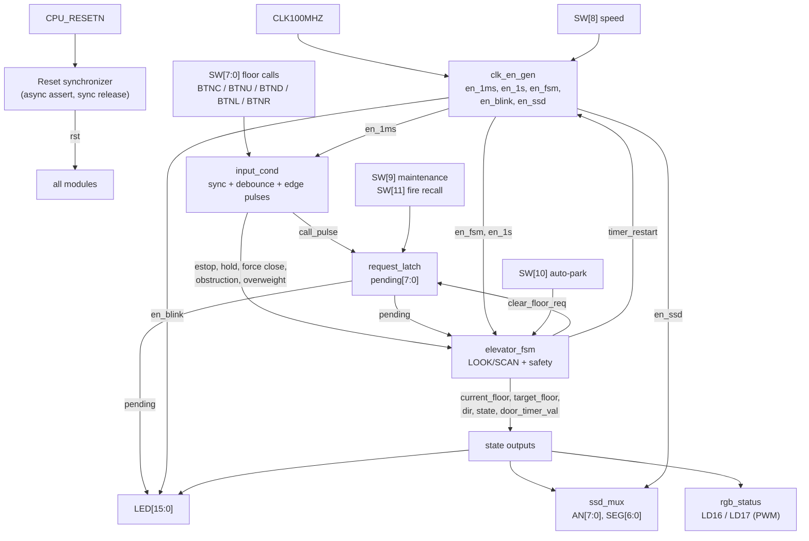
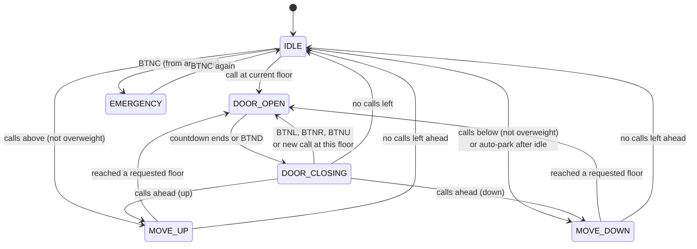

# 🛗 8-Floor Elevator Controller
 
**A complete elevator brain in Verilog, running on real FPGA hardware.**
 
LOOK/SCAN scheduling · 6-state FSM · safety interlocks · 8-digit display · single clock domain
 
---
 
## 📖 Table of Contents
 
- [Overview](#-overview)
- [Features](#-features)
- [Architecture](#️-architecture)
- [Finite State Machine](#-finite-state-machine)
- [How It Works](#-how-it-works)
- [Controls](#-controls)
- [Outputs](#-outputs)
- [Timing](#️-timing)
- [Repository Structure](#-repository-structure)
- [Getting Started](#-getting-started-vivado)
- [Troubleshooting](#-troubleshooting)
---
 
## 👀 Overview
 
An 8-floor (0 to 7) elevator controller written in Verilog for the **Digilent Nexys A7-100T** (Artix-7 `XC7A100T-1CSG324C`).
 
You call floors with the slide switches, and the cabin serves them with the **LOOK/SCAN** elevator algorithm. It moves floor by floor, opens and closes its door, and reacts to safety inputs: emergency stop, door hold, force close, obstruction, overweight and fire recall. Everything is shown on the board's LEDs, RGB LEDs and 8-digit seven-segment display.
 
The whole design runs on **one 100 MHz clock**. All slower timing comes from 1-cycle clock-enable pulses, so there are no derived clocks and no clock-domain-crossing problems.
 
> No CPU, no soft core: just a finite state machine, a few counters and careful timing.
 
### Highlights at a glance
 
| | |
|---|---|
| 🧠 **Smart scheduling** | LOOK/SCAN: keep going in the current direction, serve calls on the way, reverse only when nothing is left ahead |
| 🛡️ **Safety first** | E-stop, door hold, force close, obstruction, overweight, fire recall, maintenance mode |
| 🖥️ **Rich feedback** | 8-digit display with live status text, 16 LEDs, two PWM-dimmed RGB LEDs |
| ⏱️ **Clean timing** | One 100 MHz clock, 1-cycle enables, jitter-free timer restart |
| 🔌 **Robust inputs** | 2-FF synchronizers, ~10 ms debounce, 1-cycle edge pulses |
 
---
 
## ✨ Features
 
- **LOOK/SCAN scheduling**: keeps moving in the current direction while calls remain ahead, serves intermediate floors on the way, and reverses only when nothing is left ahead.
- **6-state FSM**: `IDLE`, `MOVE_UP`, `MOVE_DOWN`, `DOOR_OPEN`, `DOOR_CLOSING`, `EMERGENCY`.
- **Safety inputs**: E-stop (toggle), door hold, force close, obstruction sensor, overweight sensor.
- **Modes**: fast-demo speed, maintenance mode, auto-park, fire service recall.
- **Clean inputs**: 2-FF synchronizers, ~10 ms debounce on all switches and buttons, and 1-cycle edge pulses.
- **Rich feedback**: pending-call LEDs, door-timer bar graph, blinking direction LEDs, PWM-dimmed RGB status, and an 8-digit display with live status text.
---
 
## 🏗️ Architecture
 
All modules live in `elevator_top.v`.
 

 
### Module hierarchy
 
```
elevator_top.v
├── clk_en_gen        1-cycle clock enables from 100 MHz (en_fsm, en_blink, en_ssd, en_1ms, en_1s)
├── input_cond        2-FF synchronizers, ~10 ms debounce, 1-cycle edge pulses
├── request_latch     pending[7:0] call register, with maintenance & fire-recall rules
├── elevator_fsm      6-state LOOK/SCAN motion engine & safety controller
├── ssd_mux           8-digit multiplexed seven-segment display driver
└── rgb_status        PWM-dimmed dual RGB status LEDs
```
 
### Module roles
 
| Module | Role |
|---|---|
| `elevator_top` | Wires everything together, holds the reset synchronizer, the blink toggle and the LED mapping |
| `clk_en_gen` | Generates the 1-cycle enables from 100 MHz. A `restart` input realigns the movement and door timers, so each floor hop and door cycle gets its full duration |
| `input_cond` | Synchronizes and debounces every input. Floor switches, `BTNC` and `BTND` become 1-cycle pulses, while `BTNU`, `BTNL` and `BTNR` stay levels |
| `request_latch` | Holds the `pending[7:0]` floor calls. A raised switch latches a call, which is cleared when the cabin serves that floor |
| `elevator_fsm` | The brain: LOOK/SCAN direction logic, the 6 states, door timer, auto-park and all safety behavior |
| `ssd_mux` | Scans the 8 digits and decodes floor, direction and status text |
| `rgb_status` | Sets the color of both RGB LEDs from the FSM state, dimmed with a 1/16 PWM |
 
---
 
## 🔁 Finite State Machine
 

 
| State | What the cabin is doing |
|---|---|
| `IDLE` | Parked, waiting for a call. May auto-park to floor 0 after ~10 s |
| `MOVE_UP` | Travelling up, one floor per tick, stopping at pending floors |
| `MOVE_DOWN` | Travelling down, one floor per tick, stopping at pending floors |
| `DOOR_OPEN` | Door open, counting down. Hold/overweight freeze it, force-close skips it |
| `DOOR_CLOSING` | Door closing. An obstruction, overweight, hold or new call reopens it |
| `EMERGENCY` | Frozen by E-stop until the button is pressed again |
 
---
 
## ⚙️ How It Works
 
**1. Calling a floor.** Raising a switch is debounced and turned into a 1-cycle pulse. `request_latch` sets that bit in `pending[7:0]`, and `LED[7:0]` lights to show it. The bit clears when the cabin serves the floor.
 
**2. Picking a direction (LOOK/SCAN).** The FSM looks at which pending calls are above and below the current floor. While moving it keeps its direction as long as calls remain ahead, serving floors in order. When nothing is left ahead, it reverses if calls remain the other way, otherwise it goes idle. This is how real elevators avoid zig-zagging.
 
**3. Serving a floor.** On arrival the FSM clears that call, opens the door and starts the door countdown shown on `LED[12:8]`. The door reopens on an obstruction, an overweight cabin, a hold, or a fresh call to the same floor.
 
**4. Staying safe.** Emergency stop freezes the cabin from any state and latches until pressed again. Overweight blocks departure and keeps the door open. Fire recall overrides everything and sends the cabin to floor 0.
 
**5. Keeping time.** Instead of many slow clocks, one 100 MHz clock feeds counters that emit 1-cycle enable pulses (`en_1ms`, `en_1s`, `en_fsm`, `en_blink`, `en_ssd`). A `restart` signal re-aligns the timers whenever the cabin starts moving or opens a door, so the first floor hop and the door time are always full length.
 
---
 
## 🎮 Controls
 
| Input | Function |
|---|---|
| `SW[7:0]` | Floor calls (floors 0 to 7) |
| `SW[8]` | Speed: `0` = 2.0 s per floor, `1` = 0.5 s per floor (door and idle timers also run 4× faster) |
| `SW[9]` | Maintenance mode: calls to floors 1 to 7 are ignored (floor 0 still accepted) |
| `SW[10]` | Auto-park: return to floor 0 after about 10 idle seconds |
| `SW[11]` | Fire recall: clears all calls and sends the cabin to floor 0 |
| `BTNC` | Emergency stop (toggle): press to stop, press again to resume |
| `BTNU` | Hold door open (reloads the timer while held) |
| `BTND` | Force the door to close |
| `BTNL` | Obstruction sensor: reopens a closing door |
| `BTNR` | Overweight sensor: blocks departure and keeps the door open |
| `CPU_RESETN` | Master reset (red button) |
 
---
 
## 📟 Outputs
 
**Seven-segment display**
 
```
 AN7 AN6 AN5 AN4   AN3   AN2    AN1    AN0
┌───────────────┐  ┌──┐  ┌────┐ ┌───┐  ┌─────┐
│ O  P  E  n    │  │  │  │next│ │U/d│  │floor│
└───────────────┘  └──┘  └────┘ └───┘  └─────┘
  status text      blank  stop   dir   current
```
 
| Digit | Shows |
|---|---|
| `AN0` | Current floor |
| `AN1` | Direction: `U`, `d`, or blank when idle |
| `AN2` | Next stop (equals the current floor when idle) |
| `AN3` | Blank separator |
| `AN7:AN4` | Status text: `OPEn`, `CLOS`, `FULL` (overweight), `StOP` (emergency) |
 
**LEDs**
 
| LED | Meaning |
|---|---|
| `LED[7:0]` | Pending floor calls |
| `LED[12:8]` | Door countdown bar graph (5 levels) |
| `LED[13]` | Door open |
| `LED[14]` | Moving down (6 Hz blink) |
| `LED[15]` | Moving up (6 Hz blink) |
 
**RGB LEDs (LD16 and LD17):** 🟢 idle · 🔵 moving · 🟡 door open or closing · 🔴 emergency
 
---
 
## ⏱️ Timing
 
| What | Value |
|---|---|
| Master clock | 100 MHz |
| Floor travel | 2.0 s per floor (0.5 s with `SW[8]`) |
| Door countdown | 5 steps of 1 s (0.25 s with `SW[8]`) |
| Input debounce | about 10 ms |
| Direction LED blink | 6 Hz |
| Display scan | about 763 Hz step, about 95 Hz per digit |
| RGB dimming | 1/16 duty cycle |
 
Timing values are `parameter`s on `elevator_top` (`CNT_1MS_LIMIT`, `CNT_FSM_NORM`, `CNT_FSM_FAST`, `CNT_BLINK_LIMIT`), so a testbench can shrink them for fast simulation.
 
---
 
## 📁 Repository Structure
 
```
elevator-controller-nexys-a7/
├── elevator_top.v           All RTL modules
├── nexys_a7_elevator.xdc    Pin constraints (add your own)
├── block_diagram.png        System block diagram
├── fsm_state_diagram.png    FSM state diagram
└── README.md
```
 
---
 
## ⚡ Getting Started (Vivado)
 
1. Create a new RTL project for part `xc7a100tcsg324-1` (Nexys A7-100T).
2. Add `elevator_top.v` as the design source, and set `elevator_top` as the top module.
3. Add the Nexys A7 constraints file for your pins (`.xdc`).
4. Click **Generate Bitstream**, connect the board over micro-USB, then **Hardware Manager → Auto Connect → Program Device**.
**Try it on the board:**
1. Flip up a few switches (say `SW[5]` and `SW[2]`) to call those floors.
2. Watch the cabin serve them in order on `AN0`, with `U`/`d` on `AN1`.
3. Hold `BTNU` to keep a door open, or press `BTNC` to emergency-stop.
---
 
## 🧯 Troubleshooting
 
| Symptom | Likely cause |
|---|---|
| Display shows garbage or all segments lit | Wrong `AN`/`SEG` pins, or segment polarity flipped in the `.xdc` |
| Nothing responds | `elevator_top` not set as top module, or `CPU_RESETN` held low |
| Cabin crawls for ages between floors | Normal at 2 s/floor. Flip `SW[8]` up for fast mode |
| RGB LED too dim or off | Check the `{R,G,B}` pin order in the `.xdc` against the board |
| Phantom call right after reset | A switch was left up; lower it before or just after reset |
